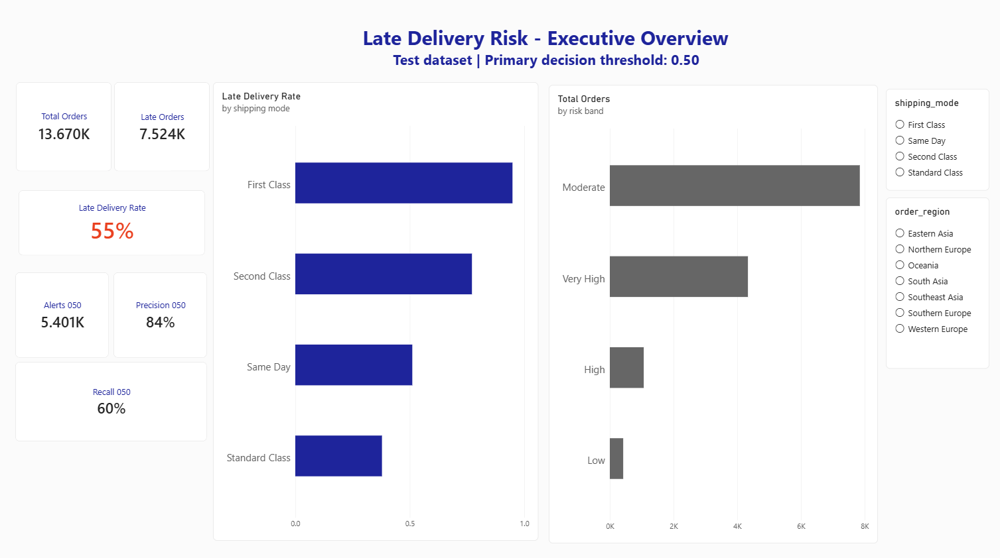
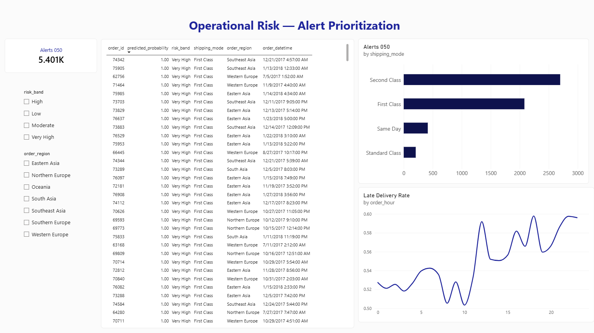
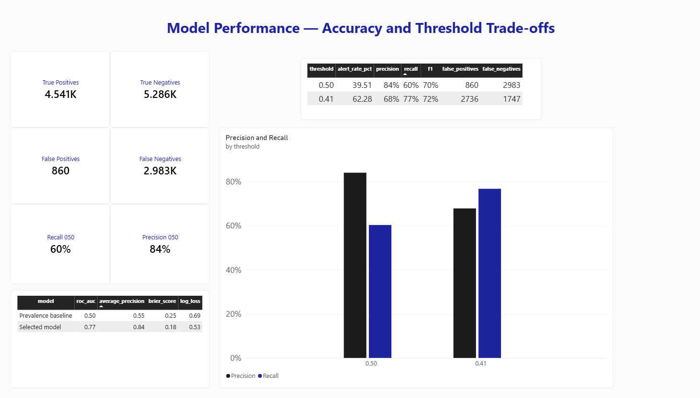
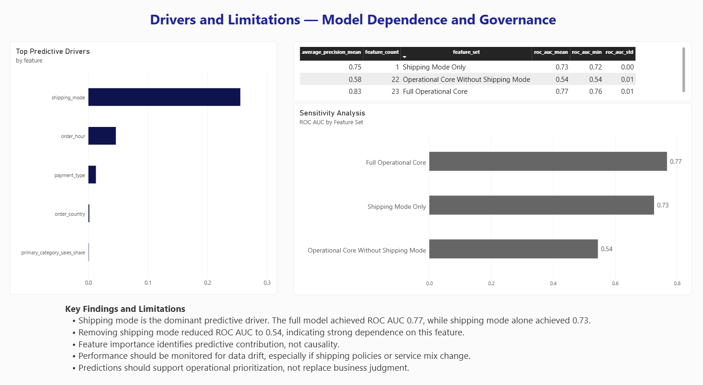

# Supply Chain Late Delivery Risk

An end-to-end machine learning and business intelligence project designed to identify orders at risk of late delivery and support proactive operational prioritization.

## Business Problem

Late deliveries affect customer satisfaction, operating costs, and supply chain reliability. This project develops a predictive solution to:

- Estimate the probability of late delivery for individual orders.
- Prioritize high-risk orders for operational intervention.
- Compare decision thresholds and their business trade-offs.
- Identify the main drivers and limitations of the model.
- Communicate results through an interactive Power BI dashboard.

## Project Workflow

1. Data quality assessment and preprocessing.
2. Exploratory analysis and feature engineering.
3. Train/test separation and model development.
4. Probability and threshold-based model evaluation.
5. Feature importance and sensitivity analysis.
6. Model and metadata export.
7. Power BI dashboard development.

## Model

- **Algorithm:** HistGradientBoostingClassifier
- **Features:** 23 operational variables
- **Primary decision threshold:** 0.50
- **Test orders:** 13,670

## Model Performance

| Metric | Result |
|---|---:|
| ROC AUC | 0.77 |
| Average Precision | 0.84 |
| Brier Score | 0.18 |
| Log Loss | 0.53 |
| Precision at 0.50 | 84% |
| Recall at 0.50 | 60% |
| F1 Score at 0.50 | 70% |

At the primary threshold of 0.50, the model generated:

- 4,541 true positives
- 5,286 true negatives
- 860 false positives
- 2,983 false negatives

## Threshold Trade-off

| Threshold | Alert Rate | Precision | Recall | F1 |
|---:|---:|---:|---:|---:|
| 0.50 | 39.51% | 84% | 60% | 70% |
| 0.41 | 62.28% | 68% | 77% | 72% |

The 0.50 threshold provides higher precision and a more focused alert volume. The 0.41 threshold captures more late deliveries but requires reviewing more orders.

## Key Findings

- Shipping mode is the dominant predictive driver.
- The full operational model achieved a ROC AUC of 0.77.
- Shipping mode alone achieved a ROC AUC of 0.73.
- Removing shipping mode reduced ROC AUC to 0.54.
- Model predictions should support operational prioritization, not replace business judgment.
- Performance should be monitored for data drift and changes in shipping policies or service mix.

## Power BI Dashboard

### 1. Executive Overview



Provides an executive summary of order volume, late-delivery rate, alert volume, precision, recall, shipping-mode performance, and risk distribution.

### 2. Operational Risk



Supports order-level prioritization using predicted probability, risk bands, shipping mode, order region, and order hour.

### 3. Model Performance



Presents the confusion matrix, probability metrics, and the precision-recall trade-off between decision thresholds.

### 4. Drivers and Limitations



Explains the main predictive drivers, feature sensitivity, model dependence, governance considerations, and limitations.

## Technologies

- Python
- pandas
- scikit-learn
- Jupyter Notebook
- Power BI
- DAX
- Git and GitHub

## Repository Structure

```text
Supply_Chain_Late_Delivery/
├── artifacts/
├── data/
├── images/
├── notebooks/
├── outputs/
├── reports/
│   └── Supply_Chain_Late_Delivery_Dashboard.pbix
├── sql/
│   └── 01_build_order_feature_mart.sql
└── README.md
```

## Exported Artifacts

- Trained late-delivery risk model.
- Model metadata.
- Order-level test predictions.
- Probability and threshold metrics.
- Feature importance results.
- Sensitivity analysis.
- Operational profiles used by Power BI.

## Limitations

- Feature importance represents predictive contribution, not causality.
- The model is strongly dependent on shipping mode.
- The analysis is based on historical data and may not represent future operational conditions.
- Predictions require ongoing monitoring and periodic validation.

## Author

**Olimpia Santacruz**

Data analytics, business intelligence, operational improvement, and value realization.